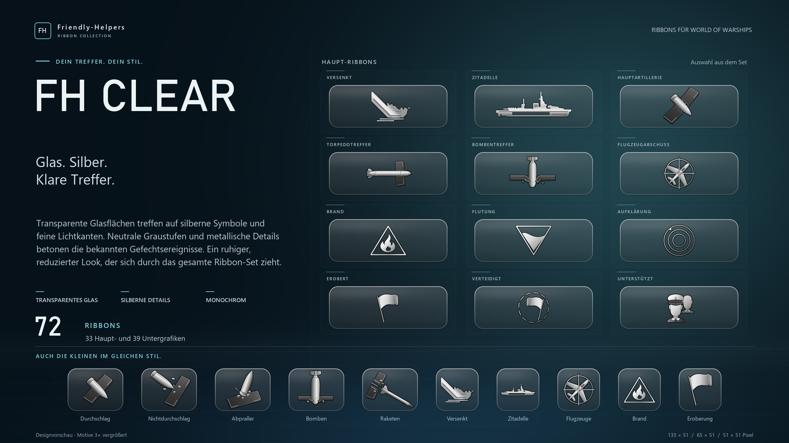
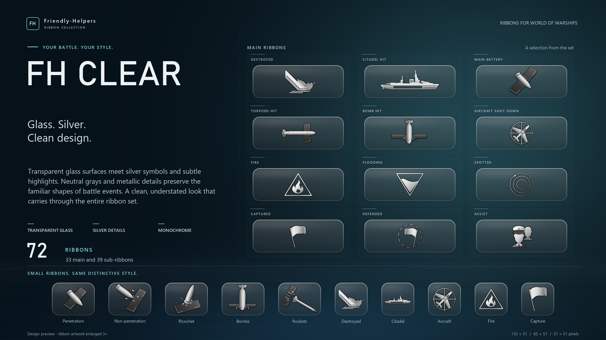

# FH Clear

**Friendly-Helpers · Ribbon Collection**

Designvorschau für World of Warships · Design showcase for World of Warships

## Deutsch

Transparente Glasflächen treffen auf silberne Symbole und feine Lichtkanten. Neutrale Graustufen und metallische Details betonen die bekannten Gefechtsereignisse. Ein ruhiger, reduzierter Look, der sich durch das gesamte Ribbon-Set zieht.

Das Set umfasst **72 Grafiken**: 33 Haupt-Ribbons, 25 rechteckige und 14 quadratische Untergrafiken.

Die Vorschau zeigt zwölf Haupt-Ribbons und zehn Untergrafiken, jeweils 3× vergrößert.

## English

Transparent glass surfaces meet silver symbols and subtle highlights. Neutral grays and metallic details preserve the familiar shapes of battle events. A clean, understated look that carries through the entire ribbon set.

The set contains **72 graphics**: 33 main ribbons, 25 rectangular sub-ribbons and 14 square sub-ribbons.

The preview shows twelve main ribbons and ten sub-ribbons, each enlarged 3×.

